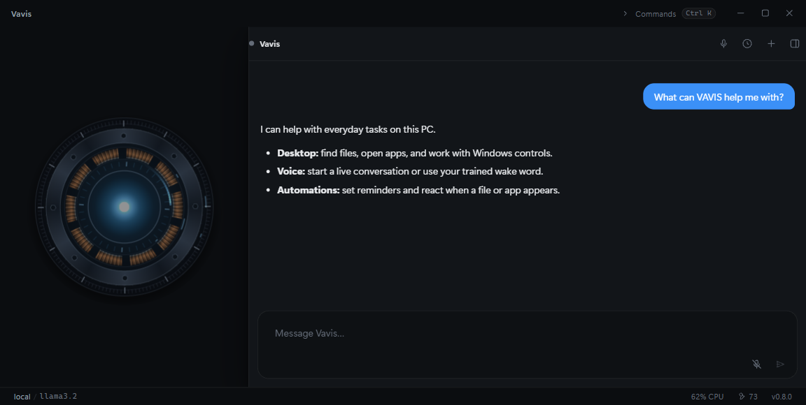

<p align="center">
  
</p>

<h1 align="center">VAVIS</h1>

<p align="center">
  A Windows assistant that can talk with you, work with desktop apps, and automate recurring tasks.
</p>

<p align="center">
  <strong><a href="https://github.com/Albis0/Vavis/releases/latest">Download for Windows</a></strong>
  &nbsp;·&nbsp; <a href="#quick-start">Quick start</a>
  &nbsp;·&nbsp; <a href="#build-from-source">Build from source</a>
</p>

<p align="center">
  <a href="https://github.com/Albis0/Vavis/actions/workflows/test.yml">
    
  </a>
</p>

<p align="center">
  
</p>

## Quick start

1. Download and open the portable `.exe` from [Releases](https://github.com/Albis0/Vavis/releases/latest). Windows WebView2 is required. See [download verification](SECURITY.md) for the checksum instructions.
2. Open **Settings → Model & keys** with `Ctrl+,`, select a provider, and enter a key or local address as needed.
3. Select **Test** to check the connection, then start a conversation. Press `Ctrl+K` when you want to find a view or setting.

| To use | What to set up |
| --- | --- |
| **A model on your PC** | Run Ollama, LM Studio, or an OpenAI-compatible server. Select **Local** and enter its address if needed. |
| **Gemini or Groq** | Get a key from [Google AI Studio](https://aistudio.google.com) or [Groq Console](https://console.groq.com). Gemini also supports live voice and semantic memory. Groq can transcribe speech with Whisper. |
| **Claude Code** | Use a Claude subscription with CLI access. [Install Claude Code](https://claude.com/code), then run `claude` in a terminal to sign in. VAVIS can detect the installation. |
| **Another hosted provider** | Use a key from your provider. Options include OpenRouter, Cerebras, GitHub Models, Mistral, and NVIDIA. OpenRouter defaults to `openrouter/free`. |

Use **Fallback** to set a provider order for requests that fail before an answer or a tool action starts. Limits, availability, and model access depend on each provider.

## What you can do

- **Conversations and memory.** The clock icon opens past conversations. Search, open, rename, or delete them. VAVIS can extract lasting facts from what you say and retrieve relevant ones by meaning. Facts are saved locally and can be viewed or removed in **Settings → Memory**.
- **Voice.** Train your wake word by saying it three times in **Settings → Voice → Wake word**. Wake-word recognition runs on the device. In wake-word mode, speech is sent for transcription after a match. The conversation microphone starts Gemini Live, which supports interruptions and tool calls. Regular transcription uses Groq Whisper or Gemini.
- **Windows controls and integrations.** Use Windows UI Automation to address controls by name, scroll, or drag. Other tools cover files, apps, sound and brightness, the clipboard, PowerShell, Spotify, Steam, Obsidian, VirusTotal, web search, image generation, and MCP servers.
- **Automations.** Schedule tasks or trigger them by CPU or battery usage, a new file, an app starting or stopping, VAVIS starting, or returning after an absence.
- **Phone access.** Connect a Telegram bot in **Settings → Phone**. It replies in private to the paired account and asks for approval on the phone before destructive actions.
- **Code.** Open a workspace through `Ctrl+K` → **Code**. The assistant can search, read, make exact-text edits, and run tests. Changes pass through the approval system, and the open file refreshes after edits.
- **Council.** Ask several models the same question and compare their answers side by side.

## Local data and approvals

VAVIS stores its database on your PC. The selected provider handles your model requests. API keys are kept separately from settings and encrypted with Windows DPAPI.

<details>
<summary>How tool permissions work</summary>

- Destructive actions ask for approval. After three destructive actions in one turn, the app can ask again even if you chose **Always allow**.
- If outside content tries to give the model instructions, every state-changing action in that turn asks again, even with full authority enabled. This includes content read directly by Claude Code and filenames from watched folders.
- Destructive requests from the phone ask for approval, and the Telegram bot only replies in private chats.
- Claude Code's own shell and write tools are disabled. VAVIS tools use the approval system. During a code turn, Claude Code's file reads are confined to the open project. Project-level hooks and `CLAUDE.md` are excluded.
- Text sent to PowerShell passes through a shared quoting routine. The app launcher rejects command interpreters and script files.

See [SECURITY.md](SECURITY.md) for the security policy and how to report problems privately.

</details>

<details>
<summary>Keyboard shortcuts</summary>

| Key | Action |
| --- | --- |
| `Ctrl+K` | Open the command palette |
| `Ctrl+,` | Open settings |
| `Ctrl+L` | Start a new conversation and keep the old one in the list |
| `Ctrl+B` | Show or hide the conversation panel |
| `Ctrl+M` | Cycle voice modes |
| `Ctrl+S` | Save the open file in Code |
| `Esc` | Stop speech or deny a pending approval |
| `F11` | Cycle window modes |

</details>

<details>
<summary>Data directory and known limits</summary>

The default data directory is `%APPDATA%\vavis\data\`. Set `VAVIS_DATA_DIR` to an absolute path to run a separate profile.

| File or directory | Contents |
| --- | --- |
| `vavis.toml` | Settings |
| `vavis.db` | Conversations, memory, automations, and the gallery index |
| `keys.dat` | Windows DPAPI-encrypted API keys |
| `wake.json` | Trained wake-word data |
| `media/` | Generated images and videos |
| `logs/` | Daily logs and crash log |

- Edge TTS may return HTTP 403. The app can fall back to Windows SAPI.
- Live voice has no acoustic echo cancellation. The app holds back quiet input during playback, and clear speech can interrupt it. Headphones reduce speaker feedback.
- A trained wake word is tuned to the voice that trained it.
- The brightness control targets built-in laptop displays.

</details>

## Build from source

Use Windows, stable Rust, Bun, and WebView2. Build the interface before running the app on a fresh checkout.

```powershell
Push-Location ui
bun install --frozen-lockfile
bun run build
Pop-Location
cargo run --release --locked -p vavis-shell
```

<details>
<summary>Architecture and verification</summary>

VAVIS replaces the TypeScript and Electron version of AEGIS/RealJarvis with Rust, Tauri, and React.

| Component | Responsibility |
| --- | --- |
| `ui/` | React and TypeScript interface built with Vite |
| `vavis-shell` | Tauri window, commands, conversations, memory, event monitoring, and Telegram |
| `vavis-tools` | Tools, approvals, agent loop, MCP client, and Claude Code bridge |
| `vavis-brain` | Providers, Claude Code CLI, embeddings, context budgets, and keys |
| `vavis-audio` | Microphone, voice activity detection, wake word, transcription, synthesis, and Gemini Live |
| `vavis-core` | Settings, SQLite storage, conversations, memory, automations, gallery, and search |

Dependencies point downward. Tool selection uses the request and the model's budget. Ordinary small talk can run without tools. The model can request additional tools with `request_tools`. Claude Code and code turns have their own selection paths.

The app starts Claude Code with `claude -p` and reads stream JSON. The tool bridge uses an authenticated loopback MCP endpoint that only accepts tool calls while a turn is active. A shared audio lock keeps queued playback and interruptions consistent. Context budgeting includes tool schemas and images.

```bash
cargo test --workspace --locked
cargo fmt --all -- --check
cargo clippy --workspace --all-targets --locked -- -D warnings
cargo test -p vavis-tools --test selection_eval -- --nocapture

# Requires a local Claude Code installation and a signed-in account.
cargo test -p vavis-tools --test claude_code_agent_e2e -- --ignored --nocapture
```

Run `bun run check` and `bun run test` from `ui/`. The application targets Windows. The core, provider, tool, and audio crates also have platform-independent logic and tests. See the [manual checklist](MANUEL_TEST.md) and [provider checklist](PROVIDER_TEST.md).

</details>

[Changelog](CHANGELOG.md) · [Support](SUPPORT.md) · [Contributing](CONTRIBUTING.md) · [Apache-2.0 license](LICENSE)
